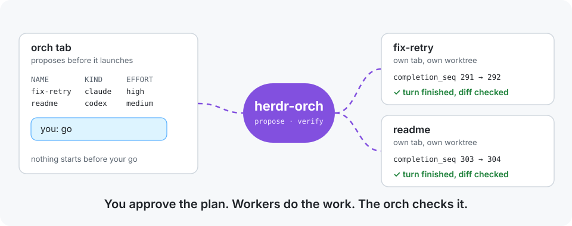

<p align="center">
  
</p>

<h1 align="center">herdr-orch</h1>

<p align="center">
  <b>Run a team of coding agents from one Herdr session.</b><br>
  You approve the plan, Claude Code and Codex workers do the work in their own tabs and worktrees,<br>
  and the orch checks every result before it reaches you.
</p>

<p align="center">
  <a href="https://github.com/smkamranqadri/herdr-orch/actions/workflows/test.yml"></a>
  <a href="LICENSE"></a>
  
  
  
</p>

You ask an agent to fix a test and update the docs at the same time. It opens two more agents,
both edit the same checkout, one of them reports "done" from its previous turn, and the result
gets merged before anyone looked at it.

herdr-orch is a skill that turns the agent you are talking to into an orch. It writes a brief for
each worker, proposes who should do what, and waits for your go. Then it starts each worker in
its own Herdr tab and worktree, knows when a turn has really finished, reads the diff, and asks
you before anything outside the plan gets in.

## Contributing

herdr-orch is young, and the most useful help right now is:

- Use it on real work and [open an issue](https://github.com/smkamranqadri/herdr-orch/issues)
  for anything the orch got wrong.
- Add or sharpen a scenario in [`evals/evals.json`](evals/evals.json), with a run that shows the
  difference.
- Keep it in step with Herdr: a new Herdr release can rename a command or a flag.

Read [CONTRIBUTING.md](CONTRIBUTING.md) before your first pull request. If herdr-orch saves you
time, a star helps other people find it.

## Quick start

```bash
curl -fsSL https://raw.githubusercontent.com/smkamranqadri/herdr-orch/main/bootstrap.sh \
  | bash -s -- install --repo https://github.com/smkamranqadri/herdr-orch.git
```

Then, in a Herdr pane:

```text
claude                       # then: /herdr-orch fix the flaky retry test and document the config
codex --sandbox danger-full-access   # then: $herdr-orch fix the flaky retry test and ...
```

The skill only runs when you call it by name. Codex needs `--sandbox danger-full-access`
because its default sandbox blocks the Herdr socket. Claude Code's auto mode blocks worker
launches, so the installer asks whether to add an auto-mode rule that allows them.

Requirements: Herdr (tested with 0.9.5), and Claude Code or Codex.

## What you get

- The orch prints one line per worker (name, kind, model, effort, tab label, worktree, and why)
  and waits for your go before it creates a worktree or a tab.
- Every worker that edits files gets its own Herdr worktree, so two workers never write to the
  same checkout. Reviewers and explorers only read, so they share the orch's checkout.
- Each worker's brief is a file you can open. The worker gets a one-line pointer to it, at launch
  and for every follow-up.
- Herdr keeps a worker's last status until the next turn changes it, so a worker can still say
  "done" from its previous turn. The orch records the worker's `completion_seq` before every
  prompt and counts the turn finished only once that number goes up.
- The orch re-runs what it can, reads the diff, and treats a worker's report as a claim. If a
  worker edited files outside its brief, you decide whether to accept the edit, send it back or
  reject it. The orch does not write product code itself.

## Safety

Workers start with their permission prompts off: Claude Code with
`--dangerously-skip-permissions`, Codex with `--yolo`. That is what lets them run unattended,
and it means a worker can run any command its user account can. The approval step, the worktree
per writer and the review before anything is accepted are there because of that. Use it on
code and machines where that trade is fine for you. [SECURITY.md](SECURITY.md) lists exactly what
it touches.

## What the evals show

Three scenarios in [`evals/`](evals/evals.json), each run once with and without the skill on
2026-10-24 (Herdr 0.9.5, Claude Code 2.1.300 with Sonnet 5.5, Codex 0.162.1):

| Scenario | Without the skill | With the skill |
| --- | --- | --- |
| Fix a test and a README in parallel | launched two workers at once in the same checkout | wrote two briefs, proposed two workers with worktrees, waited for the go |
| Ask a worker that already shows "done" | no turn tracking | recorded `completion_seq`, waited for it to rise, caught a wrong answer |
| A finished worker edited a file it did not claim | committed and merged into `main` without asking | stopped, listed the problems, and asked |

Each case ran once, so treat these as early results. The runs also showed three gaps in the
skill: worktrees created before the go, a follow-up sent as inline text, and an orch rejecting a
patch without asking. This version addresses all three; the scenarios have not been re-run
since.

## FAQ

**Do I need Herdr?** Yes. Herdr runs the tabs, worktrees and agent status that the orch drives.

**Which agent should be the orch?** Either Claude Code or Codex. The orch can start workers of
either kind, and a reviewer from the other kind is a good habit.

**Will it use my configured models?** It proposes a model and effort for each worker with a
reason, and you can change any line before you say go.

**How do I remove it?** Delete `~/.agents/skills/herdr-orch` and the `~/.claude/skills/herdr-orch`
link.

## Development

```bash
git clone https://github.com/smkamranqadri/herdr-orch.git && cd herdr-orch
tests/run.sh                        # installer runs in a temporary HOME
./bootstrap.sh install --source .   # install your working copy
```

With Herdr installed, `tests/run.sh` also checks every `herdr` command the skill names against
your Herdr.

Inspired by [herdr-orchestration](https://github.com/pedronauck/skills) by Pedro Nauck.

## License

[MIT](LICENSE)
